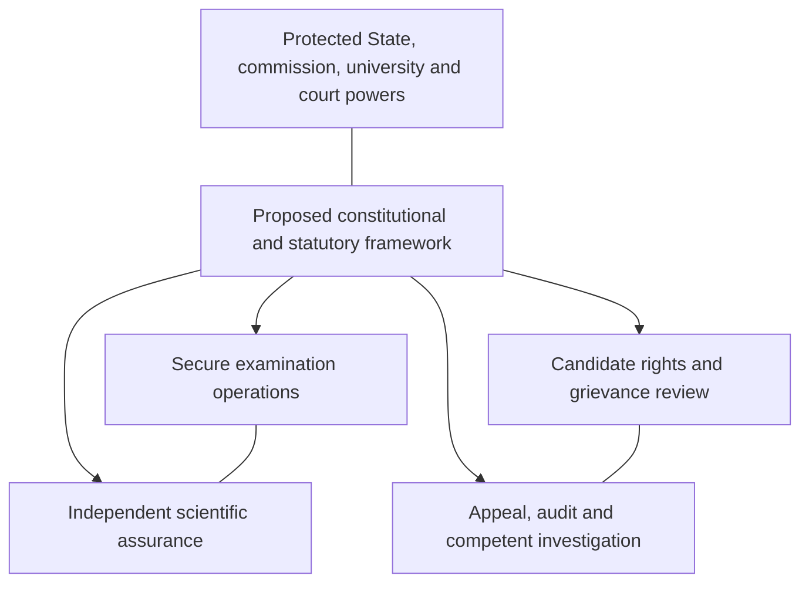

# PEXORA
### A National Architecture for Fair, Secure, Scientifically Assured and Candidate-Centred Public Examinations

**Independent, citizen-authored constitutional, legislative and public-policy research · India · 2026**

PEXORA approaches reform of Indian public examinations as a connected challenge of **assessment validity, security, candidate rights, accessibility, institutional accountability and federal competence**. Its central proposition: an examination may be secure from leaks and still be scientifically unsound, inaccessible or procedurally unfair.

> **Research status:** Citizen-authored proposal submitted in 2026 for consideration. **Not** an enacted law, government programme, institutionally endorsed project, or independently validated policy intervention.

This repository is a public research companion to an approximately **870-page original submission** (including its covering letter). The full original contains private correspondence and personal identifiers and is **not published here**. A separate 15-page public-ready Executive Legislative Brief was prepared and privacy-reviewed; **its PDF has not yet been uploaded to GitHub**. The explanatory documents below are available now.

## Start here

| Document | What it explains |
| --- | --- |
| [Executive overview](executive-summary/overview.md) | Problem statement, proposed response and status |
| [Eight-instrument map](framework/instrument-map.md) | The constitutional, legislative, policy, regulatory and validation instruments |
| [Ten proposed reforms](framework/ten-flagship-reforms.md) | Principal policy safeguards and mechanisms |
| [Institutional architecture](architecture/institutional-design.md) | Separation of examination operations, scientific assurance, candidate justice and appeal |
| [Federal limits and implementation](architecture/implementation-and-federalism.md) | Protected competencies, pilots, evidence gates and rollback |
| [Methodology and AI disclosure](methodology/research-methodology.md) | Scope, research method and assistance used |
| [Claims and evidence](methodology/claims-and-evidence.md) | What each source does and does not establish |
| [Submission timeline](submissions/submission-timeline.md) | Dated source claims and reported administrative forwarding |
| [Limitations](LIMITATIONS.md) | Legal, scientific, fiscal and empirical non-claims |
| [Publication scope](PUBLICATION_SCOPE.md) | Privacy and publication choices |

## Core research question

How can public examinations be governed so that the body running an examination does **not also exclusively validate its assessment science, decide complaints against itself and control final appeal**, without displacing protected powers of States, Public Service Commissions, universities and courts?

The proposed design has four separate functional domains:

These are **proposed** functions, not descriptions of currently operating institutions.

## Summary of proposed safeguards

- **Integrity:** secure processes and response custody, vendor accountability, separation of duties, and resilience.
- **Scientific assurance:** defensible score interpretation, validity, reliability, accessibility, language comparability and permitted uses.
- **Candidate justice:** meaningful challenges, correction, accommodation, restoration, redress and appeal.
- **Federalism:** minimum lawful safeguards while retaining reserved State and institutional decisions.
- **Implementation:** limited protected pilots, transparent readiness criteria, independent review and go / limited-go / no-go decisions.

## Evidence boundaries

| This repository documents | It does not establish |
| --- | --- |
| An extensive citizen-authored policy and legislative proposal | Enactment or governmental sponsorship |
| An eight-instrument proposed reform framework | Constitutional validity or approved drafting |
| Reported official forwarding of representations | Acceptance, adoption or substantive endorsement |
| Proposed pilots and assurance measures | Demonstrated effectiveness, scientific certification or completed field trials |

The submission and policy drafting used AI-assisted and digital tools with author direction and responsibility; details appear in [Methodology](methodology/research-methodology.md). Academic affiliations are the author's educational background, not project sponsorship.

**Author:** Harkeerat Singh · Independent research · 2026.

## Feedback and citation

The work invites scrutiny from constitutional and administrative law, examination science, accessibility, information security, public finance and public policy. For scholarly citation use [CITATION.cff](CITATION.cff) and the specific section cited. See [Rights and reuse](RIGHTS_AND_REUSE.md).

**Administrative forwarding is a traceable correspondence event, not an endorsement.**
