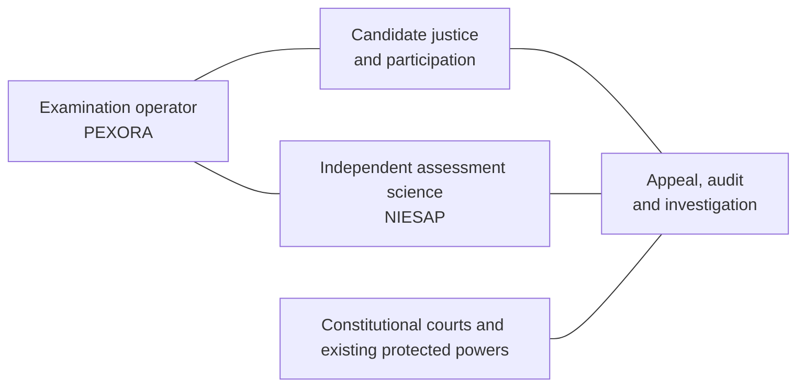

# Proposed institutional separation

The central design principle is **functional independence** between the examination operator, independent scientific assessor, candidate justice pathway, and review/investigation route.

| Functional area | Proposed role | Boundary |
| --- | --- | --- |
| **PEXORA (proposed authority)** | Examination integrity and minimum standards, centres, continuity, operational evidence, vendor oversight, candidate safeguards | Would not determine curriculum, reservations, admission policy, recruitment judgments or final appointments |
| **NIESAP (proposed independent scientific assessor)** | Validity, reliability, fairness, accessibility and language comparability; score interpretation and permitted use | Would not conduct examinations, recognise degrees or adjudicate individual candidate grievances |
| **Candidate Justice and Public Participation** | Grievance intake, timely protection, candidate-rights review, public submissions and scientific evidence docket | Does not replace technical scientific judgments or adjudicate general policy solely as an individual service complaint |
| **Appeal, Audit and Investigation** | Proposed appellate, audit, ombudsman and lawfully competent investigative routes | Criminal investigation remains with competent authorities; courts retain judicial review |

The author calls this a **four-part institutional firewall**. Its precise institutional and constitutional feasibility remains an open legislative-design question.

## Why this matters

When the same body operates an examination, validates its measurements, handles grievances and controls appeals, conflicts of interest can undermine procedural trust. The proposal separates these responsibilities so evidence and decisions can be contested independently.

**Primary source:** Executive Legislative Brief, pp. 6–8. The attached brief's diagram and limitations should be consulted before relying on this paraphrase.
